<div align="center">

<h1>PaperGalaxy · 论文星图</h1>

<p><strong>Read research papers in your own language.</strong><br/>An AI paper reader that keeps the original PDF layout — bilingual reading, argument outlines, cited Q&amp;A, figure explanations and a research agent.</p>

<p>
  <a href="LICENSE"></a>
  
  
  
  
  <a href="CONTRIBUTING.md"></a>
</p>

<p>
  <a href="README.md">中文</a> · <strong>English</strong>
</p>

<p>
  <a href="#-features">Features</a> ·
  <a href="#-getting-started">Getting started</a> ·
  <a href="#-user-guide">User guide</a> ·
  <a href="#-how-it-works">How it works</a> ·
  <a href="#-deployment">Deployment</a> ·
  <a href="#-faq">FAQ</a>
</p>

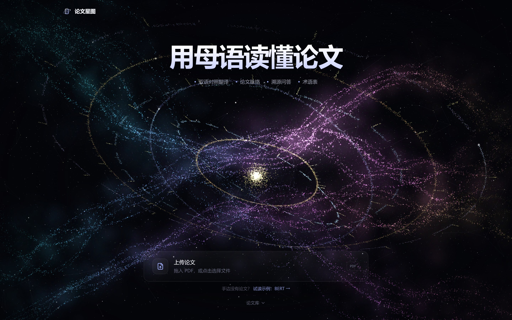

</div>

<br/>

Language is only part of what makes papers hard to read. Generic translators break the PDF layout, chatbots answer without pointing to the source, figures and equations stay opaque, and related work is scattered across several websites.

**PaperGalaxy** brings LLMs, retrieval-augmented generation (RAG), an agent, the Model Context Protocol (MCP) and multimodal understanding into a single reading workflow. Translations are placed back where the original text was, and every AI answer links back to the passage it came from. Your PDFs are processed in the browser and are never uploaded.

> The interface is currently in Chinese, and translation targets Simplified Chinese.

<br/>

## ✨ Features

<table>
<tr>
<td width="50%" valign="top">

### 📄 Layout-preserving bilingual reading
- Original / side-by-side / translation modes; translated text is typeset into each paragraph's original position
- Figures, equations and tables stay untouched; paragraphs on both pages are linked and highlighted together
- Auto-fitting font size, cursor-anchored zoom (50%–250%), dark paper mode
- Visible pages are translated first with 6 parallel requests; a paper-wide glossary keeps terms consistent

</td>
<td width="50%">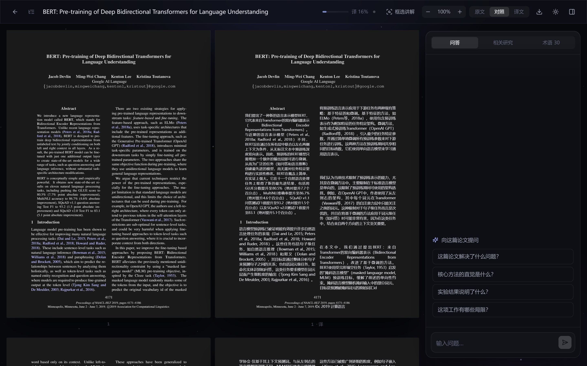</td>
</tr>
<tr>
<td width="50%">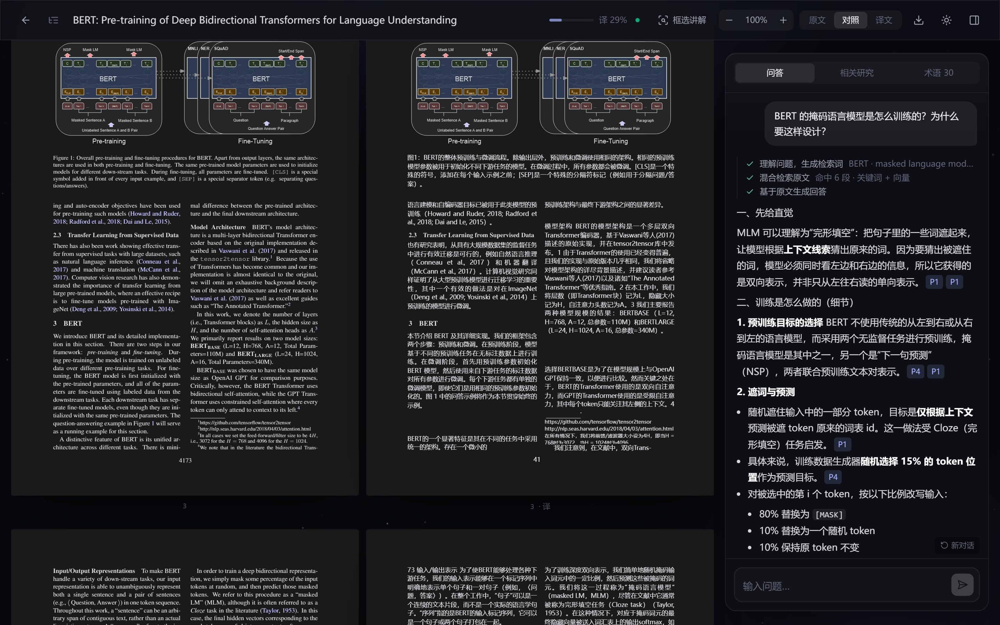</td>
<td width="50%" valign="top">

### 🧠 Understand, not just read
- **Argument outline** — problem, motivation, method, contribution, experiments, results and limitations, each linked to evidence in the text
- **Cited Q&A** — query rewriting, hybrid keyword + vector retrieval, then generation; every claim carries a clickable citation and an evidence-strength label
- **Selection tools** — translate or explain any selected text

</td>
</tr>
<tr>
<td width="50%" valign="top">

### 🔍 Figures and related work
- **Region explain** — draw a box around any figure, table or equation; a vision model explains it using the surrounding text
- **Scholar agent** — uses a bundled MCP server for arXiv and Semantic Scholar to research prior work, follow-ups and related papers, with every tool call shown live
- **Library search** — semantic search across all your papers, jumping straight to the passage

</td>
<td width="50%">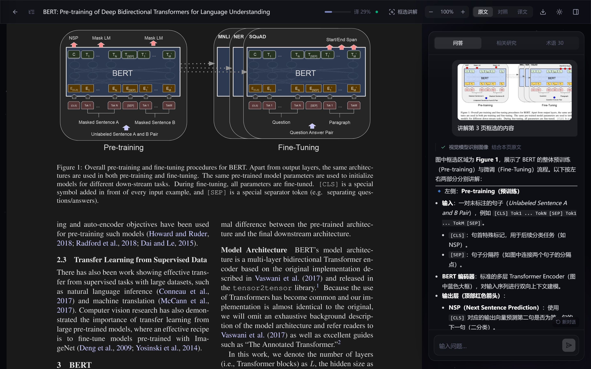</td>
</tr>
<tr>
<td width="50%">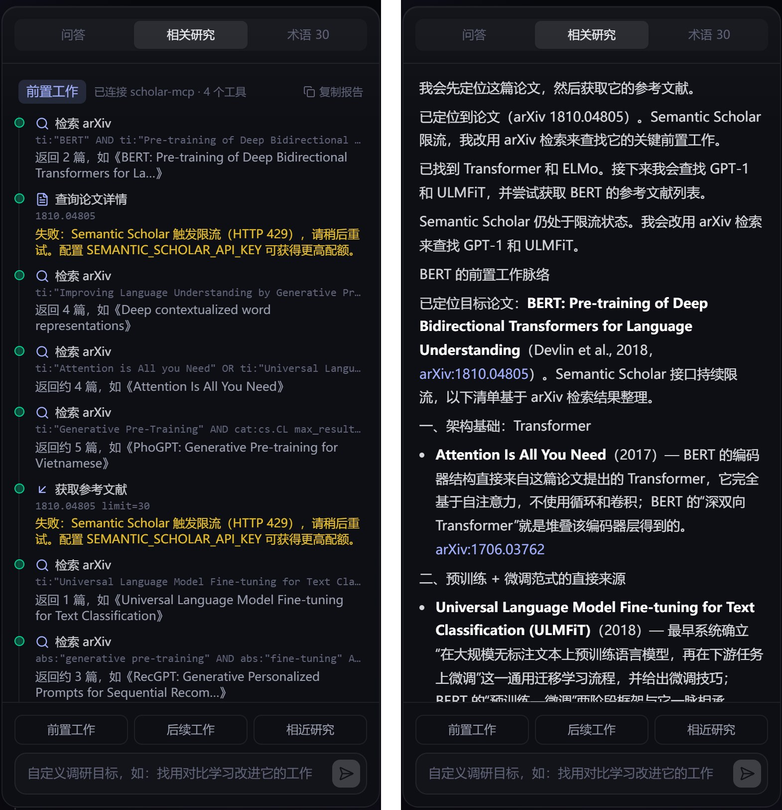</td>
<td width="50%" valign="top">

### 🔒 Local-first, ready to use
- PDF parsing, embeddings, retrieval and storage all run in the browser
- Configure models in the web UI — **any OpenAI-compatible API**; your key stays in your browser
- Chats and research reports are saved, reading position is remembered, notes export to bilingual Markdown
- Works on desktop and mobile

</td>
</tr>
</table>

<details>
<summary><b>More screenshots</b></summary>

<br/>

| Argument outline | Translation mode &amp; glossary |
|---|---|
| 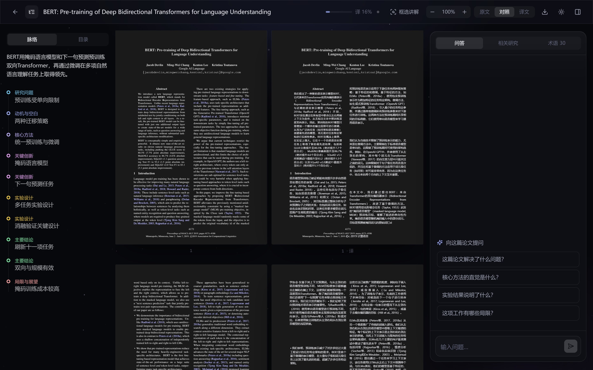 | 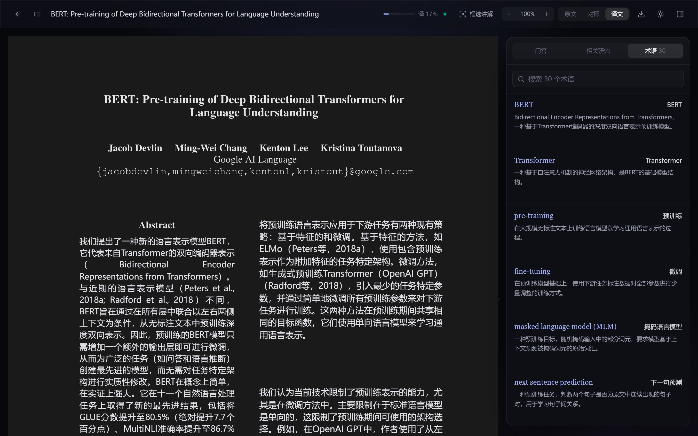 |

| Library search | Mobile |
|---|---|
| 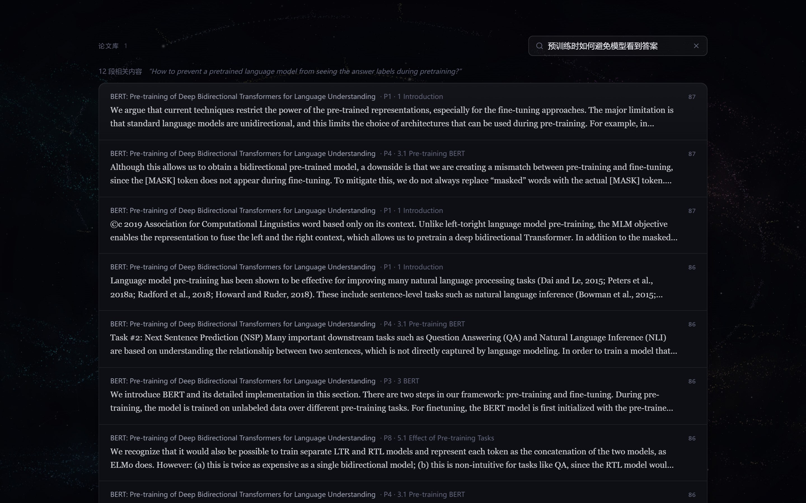 | 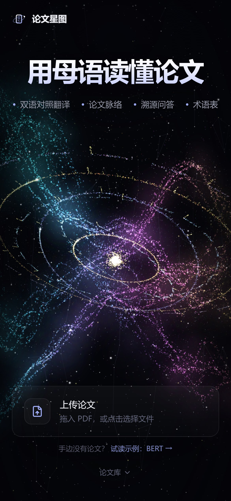 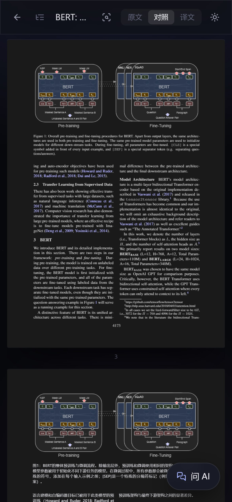 |

</details>

<br/>

## 🚀 Getting started

### 1. Requirements

- [Node.js](https://nodejs.org/) **18.18** or later (20 LTS or 22 LTS recommended)
- [Git](https://git-scm.com/)
- An API key for any OpenAI-compatible LLM service

### 2. Clone and install

```bash
git clone https://github.com/<your-username>/paper-galaxy.git
cd paper-galaxy
npm run setup
```

`npm run setup` installs dependencies for the web app and the MCP server and builds the MCP server. The first run takes 1–3 minutes.

### 3. Run

```bash
npm run dev
```

Open <http://localhost:3000>.

### 4. Configure a model in the browser

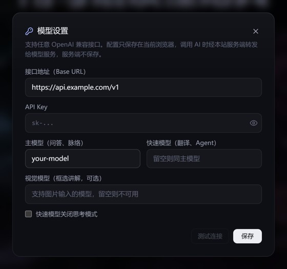

Click the **⚙ gear icon** in the top-right corner to open *Model settings*:

| Field | Description |
|---|---|
| Base URL | The provider's OpenAI-compatible endpoint, usually ending in `/v1` |
| API key | Created in your provider's console |
| Main model | Used for Q&A and outlines; pick a capable model |
| Fast model | Used for translation, query rewriting and the agent; leave empty to reuse the main model |
| Vision model | Used for region explain; must accept images. Optional |
| Disable thinking | Speeds up translation when the fast model is a reasoning model |

Click **Test connection**, then **Save**.

> 🔐 Your key is stored only in this browser (localStorage). For each AI request it is sent to this app's server and forwarded to the model provider; the server neither stores nor logs it.

<br clear="right"/>

<details>
<summary><b>Example settings for common providers</b></summary>

<br/>

Check your provider's console for current model names.

| Provider | Base URL | Main model | Vision model |
|---|---|---|---|
| DeepSeek | `https://api.deepseek.com/v1` | `deepseek-chat` | — |
| Alibaba Cloud Model Studio | `https://dashscope.aliyuncs.com/compatible-mode/v1` | `qwen-plus` | `qwen-vl-plus` |
| Zhipu AI | `https://open.bigmodel.cn/api/paas/v4` | `glm-4.5-air` | `glm-4.5v` |
| OpenAI | `https://api.openai.com/v1` | `gpt-5-mini` | `gpt-5-mini` |
| Ollama (local) | `http://localhost:11434/v1` | `qwen3:8b` | `qwen2.5vl:7b` |

For local services such as Ollama, any non-empty API key works.

</details>

### 5. Start reading

Drop a PDF onto the upload card, or click **“试读示例：BERT”** to open the bundled sample paper.

<br/>

## 📖 User guide

<table>
<tr><th width="22%">Feature</th><th>How to use it</th></tr>
<tr><td>Reading modes</td><td>Switch between original, side-by-side and translation in the top bar. Hover or click a paragraph to highlight it on both pages; click it again, click empty space or press <kbd>Esc</kbd> to clear.</td></tr>
<tr><td>Zoom</td><td>Use <kbd>−</kbd> / <kbd>+</kbd> in the top bar, or hold <kbd>Ctrl</kbd> and scroll to zoom around the cursor. Click the percentage to fit the width.</td></tr>
<tr><td>Outline &amp; contents</td><td>Open the outline from the icon on the left of the top bar. Clicking a node highlights its evidence; you can also ask follow-up questions about it.</td></tr>
<tr><td>Cited Q&amp;A</td><td>Ask in the Q&amp;A tab, in Chinese or English. Labels like <code>P3</code> are citations — hover to preview, click to jump.</td></tr>
<tr><td>Region explain</td><td>Click “框选讲解”, then drag a box over the page. The explanation appears in the Q&amp;A panel. <kbd>Esc</kbd> exits.</td></tr>
<tr><td>Selection</td><td>Select any text and choose translate or explain from the toolbar.</td></tr>
<tr><td>Glossary</td><td>The glossary tab is searchable; click a term to have the AI explain it in context.</td></tr>
<tr><td>Related work</td><td>In the related-work tab, choose prior work, follow-ups or similar papers, or type your own goal. Reports can be copied.</td></tr>
<tr><td>Library search</td><td>Below the home hero, describe what you remember in natural language to find the passage.</td></tr>
<tr><td>Export</td><td>The download icon exports bilingual Markdown: summary, outline, translation with original, and glossary.</td></tr>
</table>

<br/>

## 🏗 How it works

<div align="center">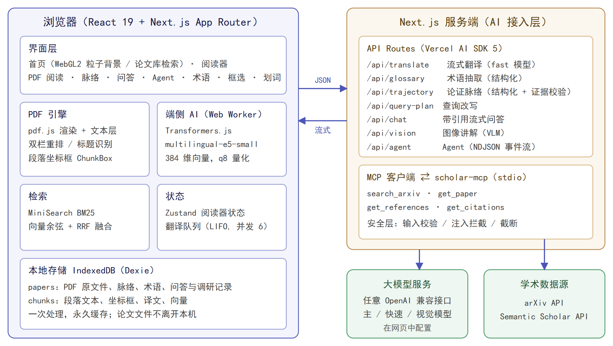</div>

<br/>

PaperGalaxy runs as a **browser-first, cloud-assisted** app. The browser handles PDF parsing, rendering, embeddings, retrieval and storage. The Next.js server is only an AI gateway: it builds prompts, calls models and MCP tools, and streams results back.

<details>
<summary><b>Layout-preserving translation</b></summary>

<br/>

1. pdf.js extracts text items with coordinates. Single- or two-column layout is detected from the column gutter. Items are then grouped into lines by baseline, with sub- and superscripts kept in their line.
2. Paragraphs are split using line spacing, indentation and sentence endings. Headings, display equations and figure labels are detected, and equations are kept out of the body text.
3. Each paragraph records its bounding boxes on the page, split across columns and pages.
4. The translation page draws the original page and typesets the translation into each box. A binary search finds the largest font that fits, stored as a CSS scale variable so zooming needs no re-layout.

</details>

<details>
<summary><b>Cited hybrid-retrieval Q&amp;A (RAG)</b></summary>

<br/>

1. **Query rewriting** turns the question into an English search query and keywords; glossary terms map translated names back to the original.
2. **Two retrieval channels**: MiniSearch BM25, plus on-device embeddings (multilingual-e5-small in a Web Worker). Each returns its top 20.
3. **Reciprocal rank fusion**: `score(d) = Σ 1 / (60 + rank_c(d))`; the top 6 passages become the context.
4. **Citation-constrained generation**: every claim must cite a paragraph id, and invented ids are removed on the server. When both channels agree on the top hit, the answer is marked as well supported.

</details>

<details>
<summary><b>Scholar agent &amp; MCP</b></summary>

<br/>

[`packages/scholar-mcp`](packages/scholar-mcp) is a standalone MCP server exposing `search_arxiv`, `get_paper`, `get_references` and `get_citations`. It works with any MCP client.

`/api/agent` starts it over stdio as an MCP client and lets the model plan up to 8 steps. Each tool call is streamed to the UI as an NDJSON event. On rate limits, the agent switches to another source.

</details>

<details>
<summary><b>Project structure</b></summary>

<br/>

```
apps/web/
  app/                 pages (home, /paper/[id]) and API routes
  components/          reader, Q&A, agent, model settings, WebGL background
  lib/ai/              model access, prompts, safety (server only)
  lib/pdf/             PDF parsing and import
  lib/rag/             on-device embeddings, hybrid retrieval
  lib/hooks/           AI preprocessing pipeline, translation queue, parser upgrades
  stores/              Zustand state (reader, model settings)
packages/scholar-mcp/  scholarly search MCP server
```

</details>

**Tech stack**: Next.js 15 · React 19 · TypeScript · Tailwind CSS 4 · Vercel AI SDK 5 · Model Context Protocol · Zod · Dexie (IndexedDB) · Zustand · pdf.js · Transformers.js · MiniSearch · WebGL2

<br/>

## 🔒 Privacy &amp; security

- **Papers stay on your device**: PDFs, parsed text, translations and embeddings live in browser IndexedDB. The server only receives the text needed for each AI request.
- **You own your key**: keys entered in the UI stay in your browser and are not stored by the server. The repository contains no secrets.
- **Prompt-injection defense**: paper content is always treated as data, and system prompts ignore instructions inside it. Out-of-scope requests are blocked.
- **Controlled output**: structured output is schema-validated with automatic retry, citations are checked on the server, and the model states clearly when the paper has no supporting evidence.

<br/>

## 🚢 Deployment

```bash
npm run build
npm run start          # port 3000; put it behind Nginx or another reverse proxy
```

- The scholar agent spawns a Node child process (stdio MCP), so deploy on a server or in a container.
- The on-device embedding model (~120 MB) can be bundled ahead of time in `apps/web/public/models`:

  ```bash
  HF_ENDPOINT=https://hf-mirror.com npm run download-model --prefix apps/web
  ```

<details>
<summary><b>Optional: server-side default model</b> (for public instances)</summary>

<br/>

Configure a default model so visitors can use the app without entering a key. Settings entered in the browser take precedence, and the two are never mixed.

```bash
cp apps/web/.env.example apps/web/.env.local   # then restart
```

| Variable | Description |
|---|---|
| `LLM_BASE_URL` / `LLM_API_KEY` / `LLM_MODEL` | Endpoint, key and model for the default model |
| `LLM_FAST_MODEL` | Fast model; defaults to the main model |
| `LLM_VISION_MODEL` | Vision model; region explain is disabled without it |
| `LLM_EXTRA_BODY` / `LLM_FAST_EXTRA_BODY` | Extra JSON merged into requests, e.g. `{"enable_thinking":false}` |
| `SEMANTIC_SCHOLAR_API_KEY` | Semantic Scholar key, reduces agent rate limiting |
| `SCHOLAR_MCP_PATH` | scholar-mcp entry; defaults to `packages/scholar-mcp/dist/cli.js` |
| `NEXT_PUBLIC_HF_ENDPOINT` | Mirror for downloading the embedding model, e.g. `https://hf-mirror.com` |

`.env.local` is git-ignored.

</details>

<br/>

## ❓ FAQ

<details>
<summary><b>There is a yellow dot next to the gear icon.</b></summary>
<br/>No model is configured yet. Open <i>Model settings</i>, fill it in and test the connection.
</details>

<details>
<summary><b>The connection test reports an invalid key or a missing model.</b></summary>
<br/>Make sure the base URL ends in a compatible path such as <code>/v1</code>, the key has no extra spaces, and the model name matches your provider's console exactly.
</details>

<details>
<summary><b>The semantic index indicator keeps spinning.</b></summary>
<br/>The ~120 MB embedding model is downloaded on first use. On slow networks, set <code>NEXT_PUBLIC_HF_ENDPOINT</code> to a mirror or bundle the model as described above. Q&amp;A falls back to keyword search until the index is ready.
</details>

<details>
<summary><b>The agent says Semantic Scholar is rate-limited.</b></summary>
<br/>The public API is rate-limited, so the agent continues with arXiv. For steadier results, request a free key and set <code>SEMANTIC_SCHOLAR_API_KEY</code>.
</details>

<details>
<summary><b>Are scanned PDFs supported?</b></summary>
<br/>Not yet. Scanned PDFs have no text layer and need OCR, which is on the roadmap.
</details>

<details>
<summary><b>What happens to previously imported papers after an upgrade?</b></summary>
<br/>When parsing rules change, older papers are re-parsed from the locally stored PDF the next time you open them. Translations of unchanged paragraphs are kept.
</details>

<br/>

## 🗺 Roadmap

- [ ] Scanned PDFs: OCR and layout analysis
- [ ] Inline equations recognized as LaTeX and typeset in translations
- [ ] Study mode: comprehension questions and review cards
- [ ] Q&amp;A evaluation set for retrieval recall and answer faithfulness
- [ ] Shared annotations and libraries

## 🤝 Contributing

Issues and pull requests are welcome — see [CONTRIBUTING.md](CONTRIBUTING.md).

## 📄 License

[MIT](LICENSE)

## 🙏 Acknowledgements

- [pdf.js](https://mozilla.github.io/pdf.js/), [Transformers.js](https://huggingface.co/docs/transformers.js), [Vercel AI SDK](https://ai-sdk.dev/), [Model Context Protocol](https://modelcontextprotocol.io/), [MiniSearch](https://lucaong.github.io/minisearch/)
- Scholarly data from the [arXiv API](https://info.arxiv.org/help/api/) and [Semantic Scholar](https://www.semanticscholar.org/product/api)
- Sample paper: Devlin et al., *BERT: Pre-training of Deep Bidirectional Transformers for Language Understanding*, NAACL 2019, from the [ACL Anthology](https://aclanthology.org/N19-1423/), licensed under [CC BY 4.0](https://creativecommons.org/licenses/by/4.0/)

<div align="center"><sub>If PaperGalaxy helps you, consider giving it a ⭐</sub></div>
